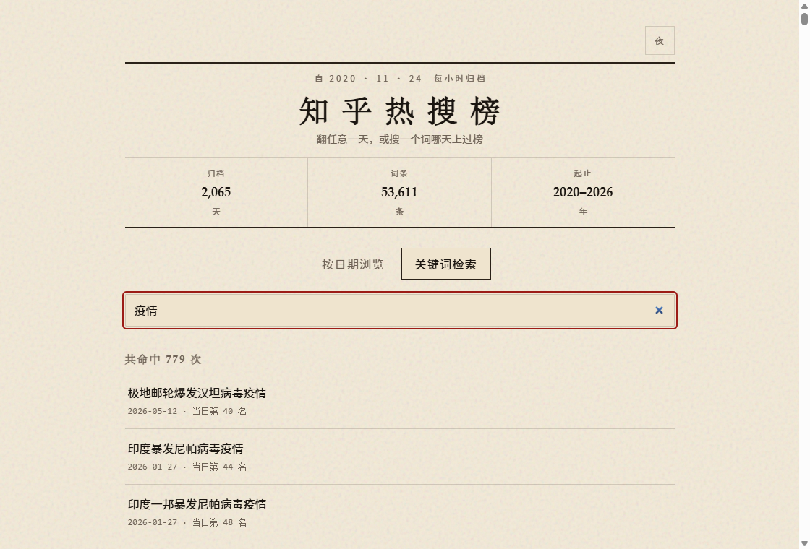

<div align="center">

# 知乎热搜榜

知乎不提供历史热搜。这个仓库从 **2020-11-24** 起每小时抓一次，按天存下来。

两千多天 · 五万多条 · 可按日翻 · 可按词搜

**[打开在线浏览](https://qcmuu.github.io/zhihu-trending-top-search/)**

[](https://github.com/qcmuu/zhihu-trending-top-search/actions)
[](https://qcmuu.github.io/zhihu-trending-top-search/)
[](LICENSE)

<p>
  <a href="https://qcmuu.github.io/zhihu-trending-top-search/"></a>
  <a href="https://qcmuu.github.io/zhihu-trending-top-search/"></a>
</p>

</div>

Hourly archive of Zhihu search trends since 2020-11-24. Browse any day, or search which days a keyword hit the list.

## 今日热搜

<!-- BEGIN -->
<!-- 最后更新时间 Fri Nov 27 2026 21:28:47 GMT+0800 (China Standard Time) -->
1. [蔡磊已进渐冻症终末期](https://www.zhihu.com/search?q=%E8%94%A1%E7%A3%8A%E5%B7%B2%E8%BF%9B%E6%B8%90%E5%86%BB%E7%97%87%E7%BB%88%E6%9C%AB%E6%9C%9F)
1. [武大教师曾某某被举报事件调查结果](https://www.zhihu.com/search?q=%E6%AD%A6%E5%A4%A7%E6%95%99%E5%B8%88%E6%9B%BE%E6%9F%90%E6%9F%90%E8%A2%AB%E4%B8%BE%E6%8A%A5%E4%BA%8B%E4%BB%B6%E8%B0%83%E6%9F%A5%E7%BB%93%E6%9E%9C)
1. [海康威视辟谣取消大小周遭员工抵制 强插](https://www.zhihu.com/search?q=%E6%B5%B7%E5%BA%B7%E5%A8%81%E8%A7%86%E8%BE%9F%E8%B0%A3%E5%8F%96%E6%B6%88%E5%A4%A7%E5%B0%8F%E5%91%A8%E9%81%AD%E5%91%98%E5%B7%A5%E6%8A%B5%E5%88%B6%20%E5%BC%BA%E6%8F%92)
1. [11月27日A股行情](https://www.zhihu.com/search?q=11%E6%9C%8827%E6%97%A5A%E8%82%A1%E8%A1%8C%E6%83%85)
1. [DeepSeek调整API定价](https://www.zhihu.com/search?q=DeepSeek%E8%B0%83%E6%95%B4API%E5%AE%9A%E4%BB%B7)
1. [男孩为求愉悦感吃20片感冒药](https://www.zhihu.com/search?q=%E7%94%B7%E5%AD%A9%E4%B8%BA%E6%B1%82%E6%84%89%E6%82%A6%E6%84%9F%E5%90%8320%E7%89%87%E6%84%9F%E5%86%92%E8%8D%AF)
1. [腾讯元宝被曝大裁员](https://www.zhihu.com/search?q=%E8%85%BE%E8%AE%AF%E5%85%83%E5%AE%9D%E8%A2%AB%E6%9B%9D%E5%A4%A7%E8%A3%81%E5%91%98)
1. [曝海康威视取消大小周遭员工抵制](https://www.zhihu.com/search?q=%E6%9B%9D%E6%B5%B7%E5%BA%B7%E5%A8%81%E8%A7%86%E5%8F%96%E6%B6%88%E5%A4%A7%E5%B0%8F%E5%91%A8%E9%81%AD%E5%91%98%E5%B7%A5%E6%8A%B5%E5%88%B6)
1. [黎曼猜想证明压缩至7.6万行](https://www.zhihu.com/search?q=%E9%BB%8E%E6%9B%BC%E7%8C%9C%E6%83%B3%E8%AF%81%E6%98%8E%E5%8E%8B%E7%BC%A9%E8%87%B37.6%E4%B8%87%E8%A1%8C)
1. [知乎与DeepSeek开展合作](https://www.zhihu.com/search?q=%E7%9F%A5%E4%B9%8E%E4%B8%8EDeepSeek%E5%BC%80%E5%B1%95%E5%90%88%E4%BD%9C)
1. [华为在美被裁定10项刑事罪名成立](https://www.zhihu.com/search?q=%E5%8D%8E%E4%B8%BA%E5%9C%A8%E7%BE%8E%E8%A2%AB%E8%A3%81%E5%AE%9A10%E9%A1%B9%E5%88%91%E4%BA%8B%E7%BD%AA%E5%90%8D%E6%88%90%E7%AB%8B)
1. [美军受控引爆5吨劣化叠氮化铅](https://www.zhihu.com/search?q=%E7%BE%8E%E5%86%9B%E5%8F%97%E6%8E%A7%E5%BC%95%E7%88%865%E5%90%A8%E5%8A%A3%E5%8C%96%E5%8F%A0%E6%B0%AE%E5%8C%96%E9%93%85)
<!-- END -->

按天的 Markdown 在 [archives](./archives)，机器可读的 JSON 在 [raw](./raw)。缺了哪些天写在 [archives/MISSING.md](./archives/MISSING.md)，目前大约 20 天，补不回来。

## 数据长什么样

`raw/2020-11-24.json` 一类，一天一个文件：

```json
[
  { "query": "嫦娥五号", "display_query": "嫦娥五号发射成功" }
]
```

`display_query` 是榜上那行字，`query` 是点进去搜的词。同一天里按 `display_query` 去重。一天会采很多次，文件是并集，不是某一小时的完整排名快照。

静态站用的是 [web/index.json](./web/index.json)：按日期压成 `[display_query, query]`，数组下标就是当天顺序。浏览器一次性加载，检索在本地做。

## 采集

GitHub Actions 每小时跑一次。先拉 `recommend_query/v2`，空了再回退 `top_search`。当天的 JSON / 归档是各小时并集；README 里的「今日热搜」只写这一次抓到的榜。日期按上海日历算，不看 runner 时区。

自己跑的话需要 [Deno](https://deno.com/)，然后：

```bash
deno run --allow-net --allow-read --allow-write --import-map=import_map.json mod.ts
deno run --allow-read --allow-write --import-map=import_map.json build_index.ts
```

Fork 之后打开 Actions 即可继续采。静态站没有后端，把 `web/` 丢到任意静态托管就能用。

## 来源

采集思路来自 [justjavac/zhihu-trending-top-search](https://github.com/justjavac/zhihu-trending-top-search)。本仓库在归档之外加了可检索的静态站。

同系列：

- [知乎热门话题](https://github.com/justjavac/zhihu-trending-hot-questions)
- [知乎热门视频](https://github.com/justjavac/zhihu-trending-hot-video)
- [微博热搜榜](https://github.com/justjavac/weibo-trending-hot-search)

## License

[MIT](LICENSE)
