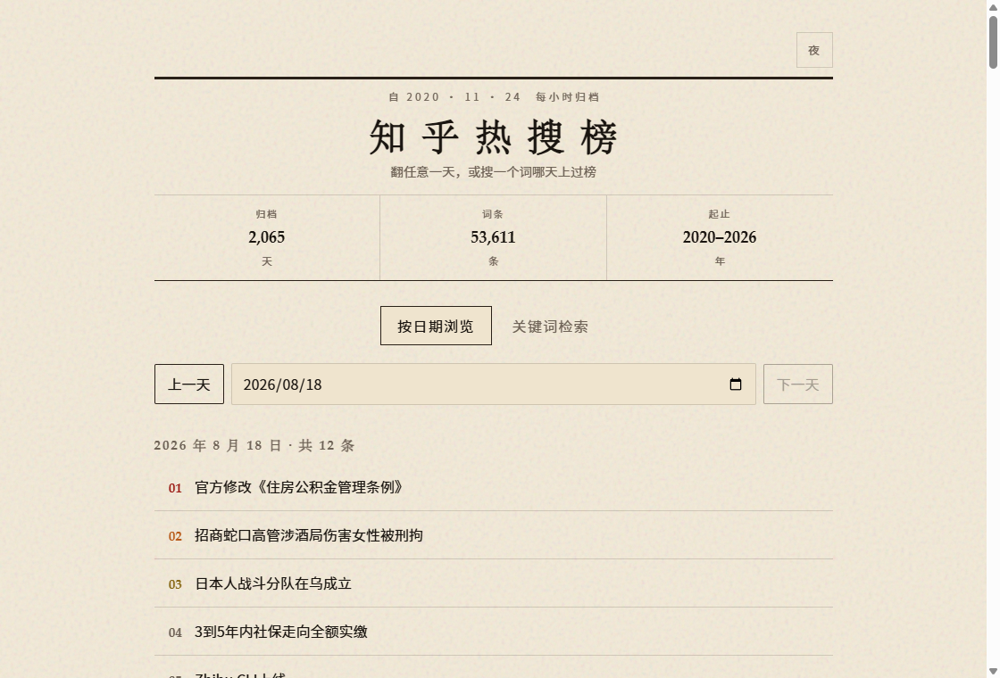

<div align="center">

# 知乎热搜榜

知乎不提供历史热搜。这个仓库从 **2020-11-24** 起每小时抓一次，按天存下来。

两千多天 · 五万多条 · 可按日翻 · 可按词搜

**[打开在线浏览](https://qcmuu.github.io/zhihu-trending-top-search/)**

[](https://github.com/qcmuu/zhihu-trending-top-search/actions)
[](https://qcmuu.github.io/zhihu-trending-top-search/)
[](LICENSE)

<p>
  <a href="https://qcmuu.github.io/zhihu-trending-top-search/"></a>
  <a href="https://qcmuu.github.io/zhihu-trending-top-search/"></a>
</p>

</div>

Hourly archive of Zhihu search trends since 2020-11-24. Browse any day, or search which days a keyword hit the list.

## 今日热搜

<!-- BEGIN -->
<!-- 最后更新时间 Thu Nov 26 2026 10:38:02 GMT+0800 (China Standard Time) -->
1. [美军受控引爆5吨劣化叠氮化铅](https://www.zhihu.com/search?q=%E7%BE%8E%E5%86%9B%E5%8F%97%E6%8E%A7%E5%BC%95%E7%88%865%E5%90%A8%E5%8A%A3%E5%8C%96%E5%8F%A0%E6%B0%AE%E5%8C%96%E9%93%85)
1. [余文乐自曝躯体化严重到不能开车](https://www.zhihu.com/search?q=%E4%BD%99%E6%96%87%E4%B9%90%E8%87%AA%E6%9B%9D%E8%BA%AF%E4%BD%93%E5%8C%96%E4%B8%A5%E9%87%8D%E5%88%B0%E4%B8%8D%E8%83%BD%E5%BC%80%E8%BD%A6)
1. [DeepSeek调整API定价](https://www.zhihu.com/search?q=DeepSeek%E8%B0%83%E6%95%B4API%E5%AE%9A%E4%BB%B7)
1. [年轻人开始劝父母卖县城空房](https://www.zhihu.com/search?q=%E5%B9%B4%E8%BD%BB%E4%BA%BA%E5%BC%80%E5%A7%8B%E5%8A%9D%E7%88%B6%E6%AF%8D%E5%8D%96%E5%8E%BF%E5%9F%8E%E7%A9%BA%E6%88%BF)
1. [蔡磊已进渐冻症终末期](https://www.zhihu.com/search?q=%E8%94%A1%E7%A3%8A%E5%B7%B2%E8%BF%9B%E6%B8%90%E5%86%BB%E7%97%87%E7%BB%88%E6%9C%AB%E6%9C%9F)
1. [黄仁勋恢复英伟达总裁CEO职务](https://www.zhihu.com/search?q=%E9%BB%84%E4%BB%81%E5%8B%8B%E6%81%A2%E5%A4%8D%E8%8B%B1%E4%BC%9F%E8%BE%BE%E6%80%BB%E8%A3%81CEO%E8%81%8C%E5%8A%A1)
1. [上海大学生宿舍坠亡两日后被发现](https://www.zhihu.com/search?q=%E4%B8%8A%E6%B5%B7%E5%A4%A7%E5%AD%A6%E7%94%9F%E5%AE%BF%E8%88%8D%E5%9D%A0%E4%BA%A1%E4%B8%A4%E6%97%A5%E5%90%8E%E8%A2%AB%E5%8F%91%E7%8E%B0)
1. [美媒称黄仁勋常态化羞辱员工](https://www.zhihu.com/search?q=%E7%BE%8E%E5%AA%92%E7%A7%B0%E9%BB%84%E4%BB%81%E5%8B%8B%E5%B8%B8%E6%80%81%E5%8C%96%E7%BE%9E%E8%BE%B1%E5%91%98%E5%B7%A5)
1. [神舟二十四号发射任务](https://www.zhihu.com/search?q=%E7%A5%9E%E8%88%9F%E4%BA%8C%E5%8D%81%E5%9B%9B%E5%8F%B7%E5%8F%91%E5%B0%84%E4%BB%BB%E5%8A%A1)
1. [AI证明黎曼猜想](https://www.zhihu.com/search?q=AI%E8%AF%81%E6%98%8E%E9%BB%8E%E6%9B%BC%E7%8C%9C%E6%83%B3)
1. [网传Anthropic称质因数分解属P](https://www.zhihu.com/search?q=%E7%BD%91%E4%BC%A0Anthropic%E7%A7%B0%E8%B4%A8%E5%9B%A0%E6%95%B0%E5%88%86%E8%A7%A3%E5%B1%9EP)
1. [两届炒股大赛冠军破产](https://www.zhihu.com/search?q=%E4%B8%A4%E5%B1%8A%E7%82%92%E8%82%A1%E5%A4%A7%E8%B5%9B%E5%86%A0%E5%86%9B%E7%A0%B4%E4%BA%A7)
<!-- END -->

按天的 Markdown 在 [archives](./archives)，机器可读的 JSON 在 [raw](./raw)。缺了哪些天写在 [archives/MISSING.md](./archives/MISSING.md)，目前大约 20 天，补不回来。

## 数据长什么样

`raw/2020-11-24.json` 一类，一天一个文件：

```json
[
  { "query": "嫦娥五号", "display_query": "嫦娥五号发射成功" }
]
```

`display_query` 是榜上那行字，`query` 是点进去搜的词。同一天里按 `display_query` 去重。一天会采很多次，文件是并集，不是某一小时的完整排名快照。

静态站用的是 [web/index.json](./web/index.json)：按日期压成 `[display_query, query]`，数组下标就是当天顺序。浏览器一次性加载，检索在本地做。

## 采集

GitHub Actions 每小时跑一次。先拉 `recommend_query/v2`，空了再回退 `top_search`。当天的 JSON / 归档是各小时并集；README 里的「今日热搜」只写这一次抓到的榜。日期按上海日历算，不看 runner 时区。

自己跑的话需要 [Deno](https://deno.com/)，然后：

```bash
deno run --allow-net --allow-read --allow-write --import-map=import_map.json mod.ts
deno run --allow-read --allow-write --import-map=import_map.json build_index.ts
```

Fork 之后打开 Actions 即可继续采。静态站没有后端，把 `web/` 丢到任意静态托管就能用。

## 来源

采集思路来自 [justjavac/zhihu-trending-top-search](https://github.com/justjavac/zhihu-trending-top-search)。本仓库在归档之外加了可检索的静态站。

同系列：

- [知乎热门话题](https://github.com/justjavac/zhihu-trending-hot-questions)
- [知乎热门视频](https://github.com/justjavac/zhihu-trending-hot-video)
- [微博热搜榜](https://github.com/justjavac/weibo-trending-hot-search)

## License

[MIT](LICENSE)
