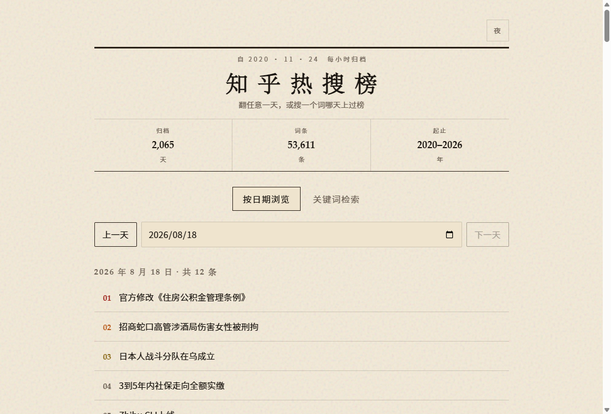
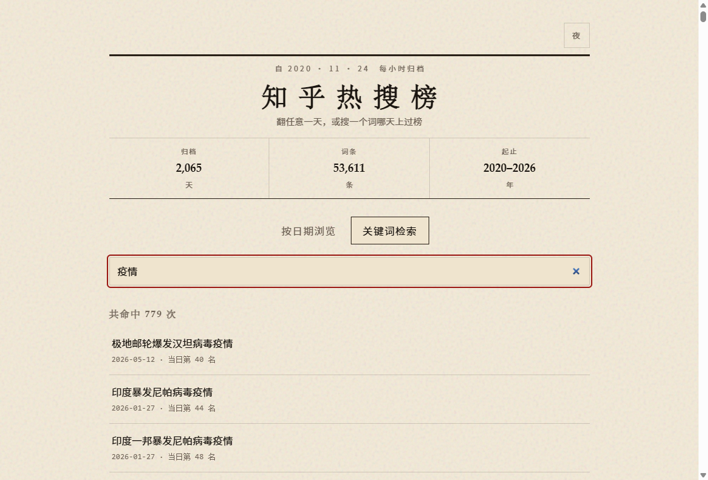

<div align="center">

# 知乎热搜榜

知乎不提供历史热搜。这个仓库从 **2020-11-24** 起每小时抓一次，按天存下来。

两千多天 · 五万多条 · 可按日翻 · 可按词搜

**[打开在线浏览](https://qcmuu.github.io/zhihu-trending-top-search/)**

[](https://github.com/qcmuu/zhihu-trending-top-search/actions)
[](https://qcmuu.github.io/zhihu-trending-top-search/)
[](LICENSE)

<p>
  <a href="https://qcmuu.github.io/zhihu-trending-top-search/"></a>
  <a href="https://qcmuu.github.io/zhihu-trending-top-search/"></a>
</p>

</div>

Hourly archive of Zhihu search trends since 2020-11-24. Browse any day, or search which days a keyword hit the list.

## 今日热搜

<!-- BEGIN -->
<!-- 最后更新时间 Wed Oct 28 2026 12:01:06 GMT+0800 (China Standard Time) -->
1. [姆巴佩涉华不当言论](https://www.zhihu.com/search?q=%E5%A7%86%E5%B7%B4%E4%BD%A9%E6%B6%89%E5%8D%8E%E4%B8%8D%E5%BD%93%E8%A8%80%E8%AE%BA)
1. [县委书记拒绝张雪为家乡打广告](https://www.zhihu.com/search?q=%E5%8E%BF%E5%A7%94%E4%B9%A6%E8%AE%B0%E6%8B%92%E7%BB%9D%E5%BC%A0%E9%9B%AA%E4%B8%BA%E5%AE%B6%E4%B9%A1%E6%89%93%E5%B9%BF%E5%91%8A)
1. [金价大跌](https://www.zhihu.com/search?q=%E9%87%91%E4%BB%B7%E5%A4%A7%E8%B7%8C)
1. [好奇岛装扮游戏](https://www.zhihu.com/search?q=%E5%A5%BD%E5%A5%87%E5%B2%9B%E8%A3%85%E6%89%AE%E6%B8%B8%E6%88%8F)
1. [反诈博主徽剑被曝遇害](https://www.zhihu.com/search?q=%E5%8F%8D%E8%AF%88%E5%8D%9A%E4%B8%BB%E5%BE%BD%E5%89%91%E8%A2%AB%E6%9B%9D%E9%81%87%E5%AE%B3)
1. [皇马称姆巴佩仅代表个人](https://www.zhihu.com/search?q=%E7%9A%87%E9%A9%AC%E7%A7%B0%E5%A7%86%E5%B7%B4%E4%BD%A9%E4%BB%85%E4%BB%A3%E8%A1%A8%E4%B8%AA%E4%BA%BA)
1. [中国足协与皇马俱乐部严正交涉](https://www.zhihu.com/search?q=%E4%B8%AD%E5%9B%BD%E8%B6%B3%E5%8D%8F%E4%B8%8E%E7%9A%87%E9%A9%AC%E4%BF%B1%E4%B9%90%E9%83%A8%E4%B8%A5%E6%AD%A3%E4%BA%A4%E6%B6%89)
1. [内塔尼亚胡阵营未获议会多数席位](https://www.zhihu.com/search?q=%E5%86%85%E5%A1%94%E5%B0%BC%E4%BA%9A%E8%83%A1%E9%98%B5%E8%90%A5%E6%9C%AA%E8%8E%B7%E8%AE%AE%E4%BC%9A%E5%A4%9A%E6%95%B0%E5%B8%AD%E4%BD%8D)
1. [毛不易婚礼致辞争议](https://www.zhihu.com/search?q=%E6%AF%9B%E4%B8%8D%E6%98%93%E5%A9%9A%E7%A4%BC%E8%87%B4%E8%BE%9E%E4%BA%89%E8%AE%AE)
1. [多方终止与姆巴佩合作](https://www.zhihu.com/search?q=%E5%A4%9A%E6%96%B9%E7%BB%88%E6%AD%A2%E4%B8%8E%E5%A7%86%E5%B7%B4%E4%BD%A9%E5%90%88%E4%BD%9C)
1. [中土网民爆发大规模互怼](https://www.zhihu.com/search?q=%E4%B8%AD%E5%9C%9F%E7%BD%91%E6%B0%91%E7%88%86%E5%8F%91%E5%A4%A7%E8%A7%84%E6%A8%A1%E4%BA%92%E6%80%BC)
1. [以色列大选](https://www.zhihu.com/search?q=%E4%BB%A5%E8%89%B2%E5%88%97%E5%A4%A7%E9%80%89)
<!-- END -->

按天的 Markdown 在 [archives](./archives)，机器可读的 JSON 在 [raw](./raw)。缺了哪些天写在 [archives/MISSING.md](./archives/MISSING.md)，目前大约 20 天，补不回来。

## 数据长什么样

`raw/2020-11-24.json` 一类，一天一个文件：

```json
[
  { "query": "嫦娥五号", "display_query": "嫦娥五号发射成功" }
]
```

`display_query` 是榜上那行字，`query` 是点进去搜的词。同一天里按 `display_query` 去重。一天会采很多次，文件是并集，不是某一小时的完整排名快照。

静态站用的是 [web/index.json](./web/index.json)：按日期压成 `[display_query, query]`，数组下标就是当天顺序。浏览器一次性加载，检索在本地做。

## 采集

GitHub Actions 每小时跑一次。先拉 `recommend_query/v2`，空了再回退 `top_search`。当天的 JSON / 归档是各小时并集；README 里的「今日热搜」只写这一次抓到的榜。日期按上海日历算，不看 runner 时区。

自己跑的话需要 [Deno](https://deno.com/)，然后：

```bash
deno run --allow-net --allow-read --allow-write --import-map=import_map.json mod.ts
deno run --allow-read --allow-write --import-map=import_map.json build_index.ts
```

Fork 之后打开 Actions 即可继续采。静态站没有后端，把 `web/` 丢到任意静态托管就能用。

## 来源

采集思路来自 [justjavac/zhihu-trending-top-search](https://github.com/justjavac/zhihu-trending-top-search)。本仓库在归档之外加了可检索的静态站。

同系列：

- [知乎热门话题](https://github.com/justjavac/zhihu-trending-hot-questions)
- [知乎热门视频](https://github.com/justjavac/zhihu-trending-hot-video)
- [微博热搜榜](https://github.com/justjavac/weibo-trending-hot-search)

## License

[MIT](LICENSE)
