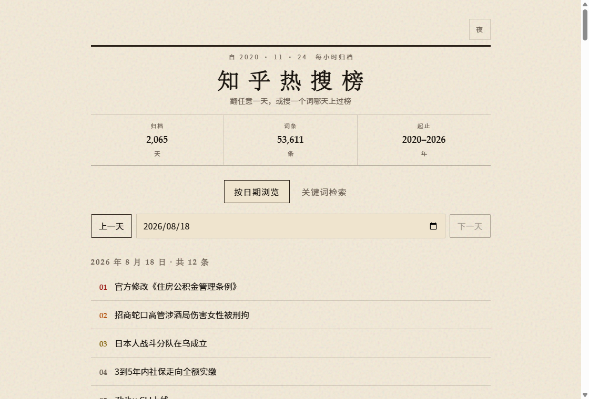
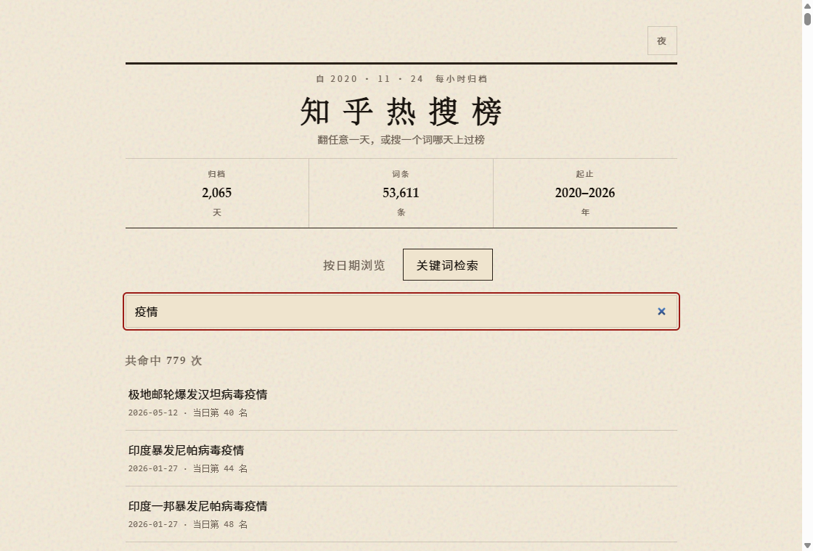

<div align="center">

# 知乎热搜榜

知乎不提供历史热搜。这个仓库从 **2020-11-24** 起每小时抓一次，按天存下来。

两千多天 · 五万多条 · 可按日翻 · 可按词搜

**[打开在线浏览](https://qcmuu.github.io/zhihu-trending-top-search/)**

[](https://github.com/qcmuu/zhihu-trending-top-search/actions)
[](https://qcmuu.github.io/zhihu-trending-top-search/)
[](LICENSE)

<p>
  <a href="https://qcmuu.github.io/zhihu-trending-top-search/"></a>
  <a href="https://qcmuu.github.io/zhihu-trending-top-search/"></a>
</p>

</div>

Hourly archive of Zhihu search trends since 2020-11-24. Browse any day, or search which days a keyword hit the list.

## 今日热搜

<!-- BEGIN -->
<!-- 最后更新时间 Sun Nov 15 2026 01:52:10 GMT+0800 (China Standard Time) -->
1. [RTX5080暴跌4000元](https://www.zhihu.com/search?q=RTX5080%E6%9A%B4%E8%B7%8C4000%E5%85%83)
1. [美国所有航班暂停起飞](https://www.zhihu.com/search?q=%E7%BE%8E%E5%9B%BD%E6%89%80%E6%9C%89%E8%88%AA%E7%8F%AD%E6%9A%82%E5%81%9C%E8%B5%B7%E9%A3%9E)
1. [业内称山姆399元羽绒服是钩子商品](https://www.zhihu.com/search?q=%E4%B8%9A%E5%86%85%E7%A7%B0%E5%B1%B1%E5%A7%86399%E5%85%83%E7%BE%BD%E7%BB%92%E6%9C%8D%E6%98%AF%E9%92%A9%E5%AD%90%E5%95%86%E5%93%81)
1. [黄仁勋再被曝出轨前高管](https://www.zhihu.com/search?q=%E9%BB%84%E4%BB%81%E5%8B%8B%E5%86%8D%E8%A2%AB%E6%9B%9D%E5%87%BA%E8%BD%A8%E5%89%8D%E9%AB%98%E7%AE%A1)
1. [黄仁勋为什么突然辞职](https://www.zhihu.com/search?q=%E9%BB%84%E4%BB%81%E5%8B%8B%E4%B8%BA%E4%BB%80%E4%B9%88%E7%AA%81%E7%84%B6%E8%BE%9E%E8%81%8C)
1. [江苏多地整改高中生超长待机](https://www.zhihu.com/search?q=%E6%B1%9F%E8%8B%8F%E5%A4%9A%E5%9C%B0%E6%95%B4%E6%94%B9%E9%AB%98%E4%B8%AD%E7%94%9F%E8%B6%85%E9%95%BF%E5%BE%85%E6%9C%BA)
1. [曝英伟达临时CEO是制衡黄仁勋重要力量](https://www.zhihu.com/search?q=%E6%9B%9D%E8%8B%B1%E4%BC%9F%E8%BE%BE%E4%B8%B4%E6%97%B6CEO%E6%98%AF%E5%88%B6%E8%A1%A1%E9%BB%84%E4%BB%81%E5%8B%8B%E9%87%8D%E8%A6%81%E5%8A%9B%E9%87%8F)
1. [交大医学院基因编辑事件官方通报](https://www.zhihu.com/search?q=%E4%BA%A4%E5%A4%A7%E5%8C%BB%E5%AD%A6%E9%99%A2%E5%9F%BA%E5%9B%A0%E7%BC%96%E8%BE%91%E4%BA%8B%E4%BB%B6%E5%AE%98%E6%96%B9%E9%80%9A%E6%8A%A5)
1. [黄仁勋在英伟达的最后数小时](https://www.zhihu.com/search?q=%E9%BB%84%E4%BB%81%E5%8B%8B%E5%9C%A8%E8%8B%B1%E4%BC%9F%E8%BE%BE%E7%9A%84%E6%9C%80%E5%90%8E%E6%95%B0%E5%B0%8F%E6%97%B6)
1. [DeepSeek发布全家桶应用API](https://www.zhihu.com/search?q=DeepSeek%E5%8F%91%E5%B8%83%E5%85%A8%E5%AE%B6%E6%A1%B6%E5%BA%94%E7%94%A8API)
1. [英伟达超97%员工希望黄仁勋回归](https://www.zhihu.com/search?q=%E8%8B%B1%E4%BC%9F%E8%BE%BE%E8%B6%8597%25%E5%91%98%E5%B7%A5%E5%B8%8C%E6%9C%9B%E9%BB%84%E4%BB%81%E5%8B%8B%E5%9B%9E%E5%BD%92)
1. [库克被提名为黄仁勋潜在继任者](https://www.zhihu.com/search?q=%E5%BA%93%E5%85%8B%E8%A2%AB%E6%8F%90%E5%90%8D%E4%B8%BA%E9%BB%84%E4%BB%81%E5%8B%8B%E6%BD%9C%E5%9C%A8%E7%BB%A7%E4%BB%BB%E8%80%85)
<!-- END -->

按天的 Markdown 在 [archives](./archives)，机器可读的 JSON 在 [raw](./raw)。缺了哪些天写在 [archives/MISSING.md](./archives/MISSING.md)，目前大约 20 天，补不回来。

## 数据长什么样

`raw/2020-11-24.json` 一类，一天一个文件：

```json
[
  { "query": "嫦娥五号", "display_query": "嫦娥五号发射成功" }
]
```

`display_query` 是榜上那行字，`query` 是点进去搜的词。同一天里按 `display_query` 去重。一天会采很多次，文件是并集，不是某一小时的完整排名快照。

静态站用的是 [web/index.json](./web/index.json)：按日期压成 `[display_query, query]`，数组下标就是当天顺序。浏览器一次性加载，检索在本地做。

## 采集

GitHub Actions 每小时跑一次。先拉 `recommend_query/v2`，空了再回退 `top_search`。当天的 JSON / 归档是各小时并集；README 里的「今日热搜」只写这一次抓到的榜。日期按上海日历算，不看 runner 时区。

自己跑的话需要 [Deno](https://deno.com/)，然后：

```bash
deno run --allow-net --allow-read --allow-write --import-map=import_map.json mod.ts
deno run --allow-read --allow-write --import-map=import_map.json build_index.ts
```

Fork 之后打开 Actions 即可继续采。静态站没有后端，把 `web/` 丢到任意静态托管就能用。

## 来源

采集思路来自 [justjavac/zhihu-trending-top-search](https://github.com/justjavac/zhihu-trending-top-search)。本仓库在归档之外加了可检索的静态站。

同系列：

- [知乎热门话题](https://github.com/justjavac/zhihu-trending-hot-questions)
- [知乎热门视频](https://github.com/justjavac/zhihu-trending-hot-video)
- [微博热搜榜](https://github.com/justjavac/weibo-trending-hot-search)

## License

[MIT](LICENSE)
